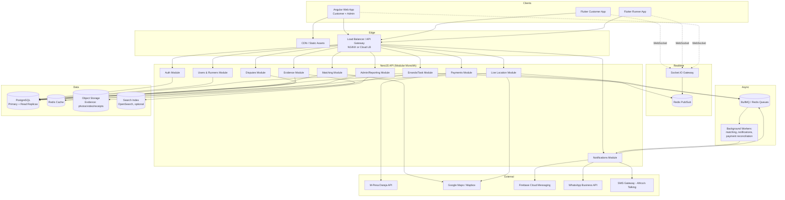
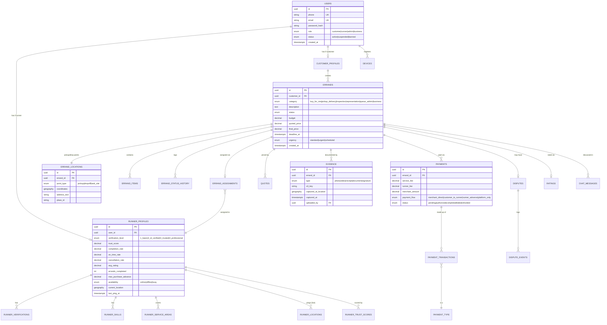
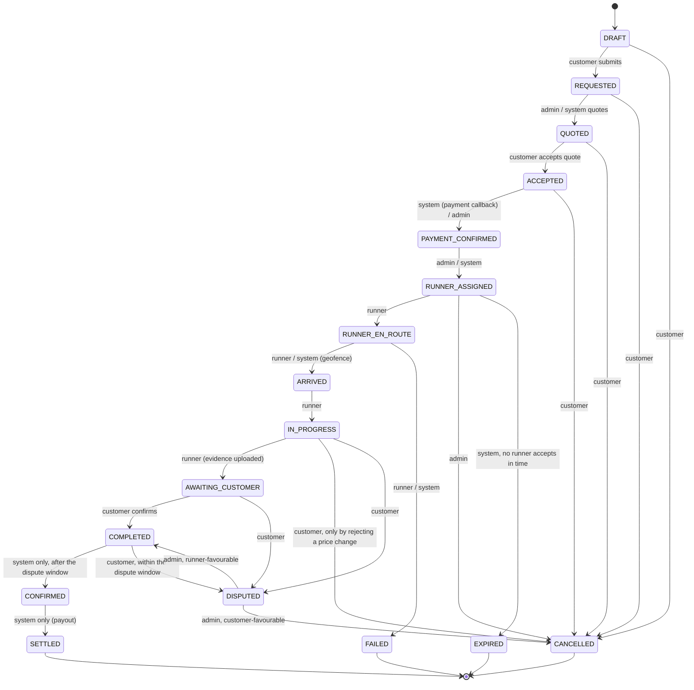
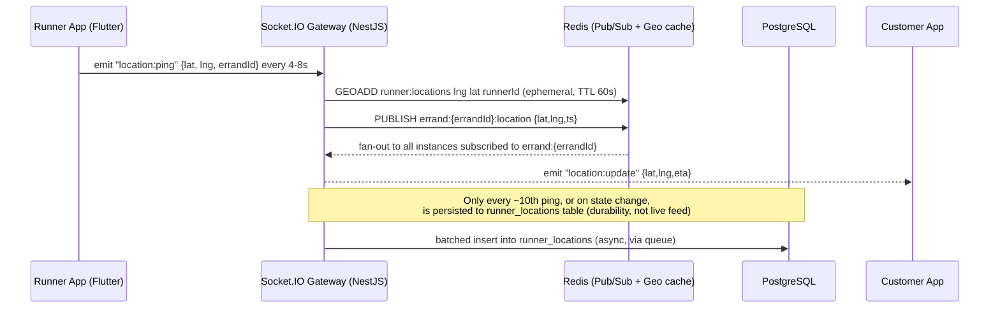
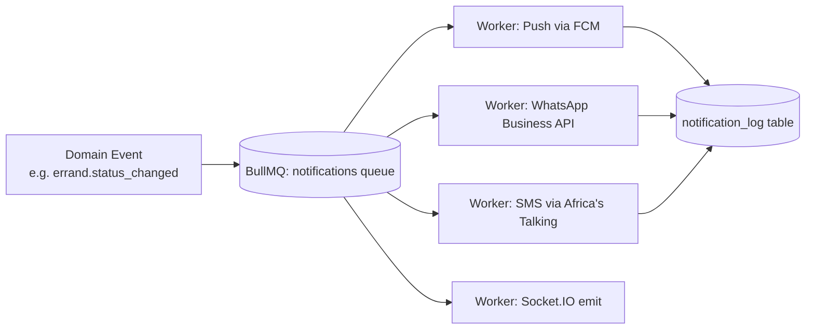
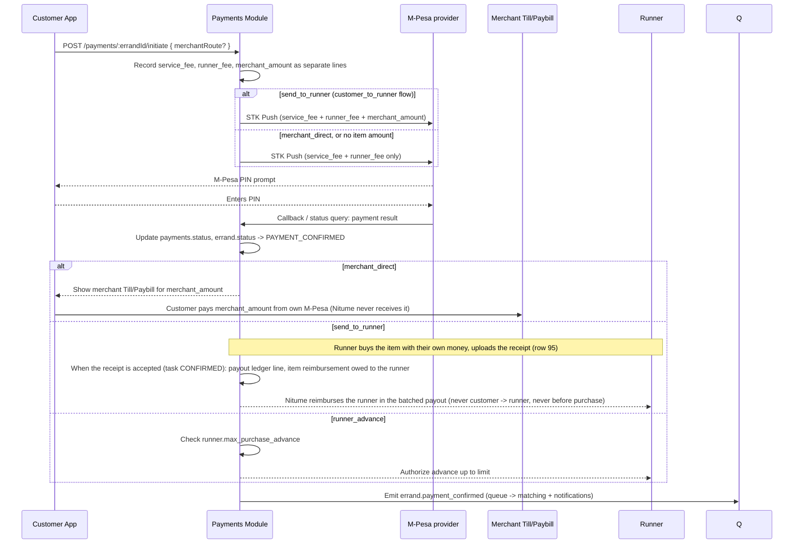
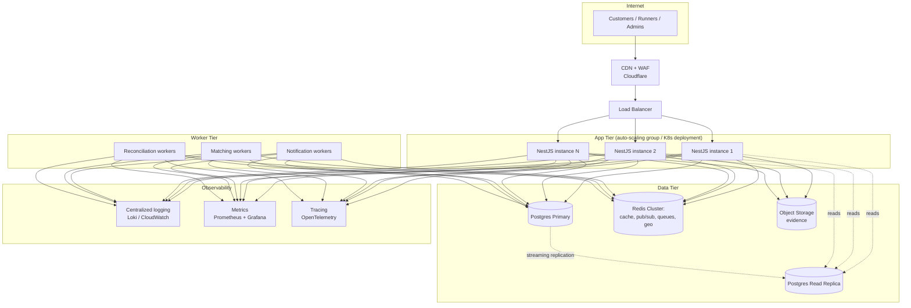

# Nitume — System Design

**Stack:** NestJS (API) · Angular (Web) · Flutter (iOS/Android — Customer & Runner apps) · PostgreSQL · Redis · Kafka/BullMQ · Socket.IO

This document translates the Nitume business plan into a concrete, buildable architecture: services, data model, real-time location/notifications, maps integration, and how the system scales.

---

## 1. Architecture Overview

Nitume starts as a **modular monolith** in NestJS — one deployable API split into strict internal modules — not microservices. At MVP scale (hundreds–low thousands of tasks/day) microservices add operational cost without a matching benefit. The modular boundaries are drawn so that any module (Payments, Location, Notifications) can be **peeled out into its own service later** without a rewrite, once volume justifies it (Section 9 covers exactly when/how).



**Why this shape:**
- **One API, many modules** keeps deployment, transactions and local development simple while the business is still discovering its shape.
- **Socket.IO + Redis Pub/Sub** handles everything "live": Runner GPS pings, task status changes, chat, arrival alerts — without polling.
- **BullMQ (Redis-backed queues)** handles anything that shouldn't block an HTTP request: sending notifications, running the matching algorithm, reconciling payments, generating reports.
- **PostgreSQL with read replicas** is the system of record; **Redis** is purely for speed (caching, live location, rate limiting, pub/sub) and is never the source of truth for anything financial.

---

## 2. Domain Data Model

### 2.1 Entity-Relationship Diagram



### 2.2 Notes on Key Tables

- **`runner_profiles.current_location`** is a PostGIS `geography(Point, 4326)` column, updated on every location ping *only for the summary/last-known value* — the high-frequency raw ping stream lives in Redis (Section 4), not Postgres, to avoid write-amplifying the primary database.
- **`errand_status_history`** is append-only — never update a row, always insert the next state. This is what powers both the customer-facing timeline and dispute resolution evidence.
- **`payments`** is a ledger of payment events per errand, never a stored balance: no customer wallet, no escrow, no "money held" figure (per the business plan). `merchant_amount` records the item/merchant amount, and `payment_flow` says how it was settled. The three flows stay separate records: service fee, runner fee, merchant/item amount.
  - `merchant_direct`: the customer pays the merchant's Till/Paybill from their own M-Pesa. Nitume never receives it; `merchant_amount` is for accounting visibility only. A price increase on this route is also paid by the customer, manually, to the same Till/Paybill (row 67).
  - `customer_to_runner` (customer-facing route `send_to_runner`): **platform-mediated** (rows 42, 66). The customer pays the item amount **to Nitume** in the same M-Pesa STK as the fees (one combined charge, row 76), and Nitume then pays the runner through the **payout ledger**. There is never a direct customer-to-runner transfer. The item amount stays its own line and its own ledger entry, never part of the service or runner fee.
    - **Timing (row 95, owner 2026-10-12)**: "Runner send_to_runner item amounts are reimbursed after the receipt is uploaded/accepted, not advanced before purchase." The runner buys the item first; Nitume **reimburses** the item amount through the payout ledger. Nothing is paid to the runner for the item before the purchase. "Accepted" means the task reaches CONFIRMED (decided, owner 2026-10-13, row 104); see §6 "Runner reimbursement".
  - `runner_advance`: a documented Runner advance capped by `runner_profiles.max_purchase_advance`; runner-side only, never a customer choice.
  - **Purchase limit (decided, owner 2026-10-13, row 108)**: "Runner out-of-pocket purchases are limited by max_purchase_advance, and a runner may decline a task when the required purchase exceeds their configured limit." The same `runner_profiles.max_purchase_advance` caps what a runner is expected to spend from their own money on a `send_to_runner` purchase; a task whose required item amount is above the runner's limit may be declined by that runner without penalty.
- **`runner_payout_lines`** (runner payout ledger; schema approved, owner 2026-10-13, row 107: "Approve the runner payout ledger table. Build it now. It must support distinct financial lines for runner fee, item reimbursement, corrections, reversals, and re-sent payouts."): append-only ledger of what Nitume owes and pays each runner. Never a stored balance: the Runner app's "available balance" is computed from these lines (due minus paid out). Built on `feat/api-owner-answers-6` (migration `1790101400000`): `id`, `runnerProfileId` FK, `errandId` FK (not null), `kind` (`runner_fee | item_reimbursement | correction | reversal | resent_payout`), `status` (`on_hold | payable | paid | rejected` for obligations, `recorded` for adjustments), `requestedAmount`, `amount` (unsigned; null while on hold or rejected), `capAmount`, `reviewReason` (`receipt_missing | receipt_mismatch | out_of_pocket_claim | over_purchase_limit`), `receiptEvidenceId`, `relatedLineId` (adjustments → the obligation they change), `previousReference`, `previousAmount`, `payoutReference`, `paidAt`, `paidByUserId`, `note`, `decisionNote`, `decidedByUserId`, `decidedAt`, `createdByUserId`, `createdAt`, `updatedAt`. One obligation per errand and kind. Append-only (DELETE and TRUNCATE refused); an obligation only moves `on_hold → payable | rejected`, `payable → paid`, or (an unpaid item line) `payable → on_hold`; `paid` and `rejected` are final; adjustments are never updated. Payouts are not rows: one manual M-Pesa payout marks 1–50 payable lines of one runner `paid` with one receipt, and the runner's feed shows it as one derived `payout` entry with signed amounts. Runner reads: `GET /runners/me/earnings` (available, pending, on hold, paid, EAT week) and `GET /runners/me/payout-lines`, all derived from the lines. Runner fee and item reimbursement are always separate lines (three-flow separation).
  - `platform_only`: no item amount.
  - Owner rows quoted: row 66, "Update §2.2 and §6 to reflect the agreed platform-mediated send-to-runner flow: the customer pays Nitume, and Nitume subsequently facilitates payment to the runner." Row 76, "one combined STK (service + runner + item) as the API is built; receipt shows the item amount on its own line." Row 67, "The customer pays the additional amount manually to the same merchant Till."
- **`errand_assignments.declineReason`** (decided, owner 2026-10-13, row 134): nullable enum `over_purchase_limit` (migration `1790101500000`), recorded when a runner declines an offer above their purchase limit.
- **`runner_profiles` (decided, owner 2026-10-13)**: `skills` use the six category values, migrated from the old `RunnerSkill` enum (row 115); `service_areas` come from an ops-configured list (row 116); `max_purchase_advance` defaults to KES 3,000 and is set per runner by admins only, every change audited with actor, time, previous and new value; runners cannot change it (row 138). Approved new records: **runner payout requests** (row 117: "Add a dedicated payout-request record, auditable through its lifecycle"; table below, rows 146, 153, 165, 166), the **purchase-limit audit** (row 138), and the **combined-cap override** record (rows 145, 160, below). `runner_payout_lines` stores the `max_purchase_advance` in force when the obligation was created (`purchaseLimitAtCreation`, migration `1790102100000`, row 152; never recalculated with a later limit); the per-reimbursement **purchase-limit exception** is a row in `task_exposure_overrides` (row 151).
- **`task_exposure_overrides`** (approved, owner 2026-10-16, rows 145, 160: "approve the existing override table and the extra audit columns"): append-only record of every explicit ops override of the task-level combined exposure cap (row 136) and of every purchase-limit exception (row 142; `source` `purchase_limit`, migration `1790102200000`). Records at least the task and assignment, the runner, the previous `max_purchase_advance`, the approved amount, the reason, the approving admin and the creation time (row 160). **No `scope` column** (row 160: "task-level exception only; add a scope model if overrides ever apply to runner/category/period/global"). Row 160 also lists an "updated timestamp"; the table is append-only, so whether a column equal to `createdAt` is wanted is still to be confirmed with the owner (api-contract).
- **`runner_payout_requests`** (approved, owner 2026-10-16, rows 153, 165, 166; built on `main`, migration `1790102300000`, `feb1dcc`): `id`, `runnerProfileId` FK, `requestedAmount` (immutable after creation), `paidAmount` (null until paid; the total of the whole lines actually paid, may be below `requestedAmount`, row 146), `status`, `destinationPhone` (the sign-in phone, row 118), `payoutReference`, `decidedByUserId`, `decidedAt`, `decisionNote`, `createdByUserId` (the authenticated runner who submitted, set server-side, never from the client, immutable, row 165), `createdAt`, `updatedAt` (time of the most recent change, row 165); `payoutRequestId` on the lines paid. **Status lifecycle (row 166)**: PENDING → PAID | REJECTED | CANCELLED; PENDING is the built value `requested`, so the stored values are `requested | paid | rejected | cancelled`. PAID, REJECTED and CANCELLED are terminal; no reopening. One open (`requested`) request per runner. **Cancel (row 166, to build)**: ops only, with a mandatory free-text reason; recorded in `cancelledByUserId`, `cancelledAt`, `cancellationReason`; `requestedAmount` unchanged; the runner cannot cancel, and if still owed makes a new request.
- **`refund_reviews`** (rows 37, 62, 71, 94) are records, not task states: several per errand (one cancellation-type review, one per approved `send_to_runner` price decrease). Triggers: `price_change_rejected`, `dispute_customer_favourable`, `cancelled_after_payment`, `price_change_decrease`, and (row 102, owner 2026-10-12) `expired_after_payment`, `failed_after_payment`. A review's payout columns (`payoutReference`, `paidAt`, `paidByUserId`) are **immutable** once it is `refunded` (row 82).
- **`refund_payout_corrections`** (row 100, owner 2026-10-12: "Build the auditable correction/reversal schema now. Original payout/receipt records remain immutable; corrections/reversals are represented separately."): append-only, one row per correction, linked to its refund review. Proposed columns: `id`, `refundReviewId` FK, `kind` (`corrected | reversed | resent`), `previousReference`, `previousAmount` (snapshot of the effective payout before this record), `newReference` (nullable; the corrected receipt, the reversal receipt, or the re-sent receipt), `newAmount` (nullable; the amount actually sent, when it changes), `reason` (required), `createdByUserId`, `createdAt`. Never updated or deleted. The **effective payout** of a review is the original payout with its corrections applied in order; customers and reconciliation use the effective payout. Decided by the owner 2026-10-13:
  - **Ceiling (row 110)**: "A correction must not record an amount above the applicable refund ceiling." `newAmount` is refused above the review's correction ceiling.
  - **Cumulative cap after a reversal (row 111)**: "A reversed, not-yet-re-sent payout remains committed at the decided refund amount until the obligation is resolved/re-sent, and therefore continues to count against the cumulative refund cap." For the cumulative cap (row 87) a review counts at its effective payout while sent, and at its decided `refundAmount` while reversed and not yet re-sent (never 0).
  - **Customer notification (row 109)**: "Customer notification is required for a re-sent payout. Internal payout corrections/reversals do not notify the customer by default." Only a `resent` record notifies the customer (`Refund sent`).
- Use **PostGIS** (`CREATE EXTENSION postgis`) for all geo columns and queries — `ST_DWithin`, `ST_Distance` power Runner search radius and matching.

### 2.3 Indexing Strategy

| Table | Index | Purpose |
|---|---|---|
| `errands` | `(status, category, created_at)` | Admin/ops dashboards, matching queue |
| `runner_profiles` | GiST index on `current_location` | Radius search for nearby Runners |
| `errand_status_history` | `(errand_id, created_at)` | Timeline reconstruction |
| `payments` | `(errand_id)`, `(status, created_at)` | Reconciliation jobs |
| `evidence` | `(errand_id, type)` | Fetching evidence by task |
| `users` | unique `(phone)`, unique `(email)` | Auth lookups |

---

## 3. NestJS Backend Architecture

### 3.1 Module Breakdown

```
src/
├── auth/                # JWT auth, OTP (phone), refresh tokens, RBAC guards
├── users/                # User accounts, roles
├── runners/              # Runner profiles, verification, skills, service areas
├── customers/            # Customer profiles, saved addresses, recurring tasks
├── errands/               # Task CRUD, category rules, state machine
├── matching/              # Runner search & assignment algorithm
├── pricing/                # Quote engine (base + distance + urgency + complexity)
├── payments/               # Payment orchestration (service/runner/merchant flows)
├── mpesa/                   # Daraja STK Push, C2B/B2C callbacks
├── location/                 # Live GPS ingestion, geofencing, ETA
├── notifications/              # Push/SMS/WhatsApp/email dispatch
├── evidence/                    # Upload handling, S3 signed URLs
├── disputes/                     # Dispute workflow & evidence review
├── ratings/                       # Post-task ratings/reviews
├── chat/                           # In-task customer↔runner messaging
├── admin/                           # Ops dashboard endpoints, reporting
├── realtime/                        # Socket.IO gateway(s)
├── common/                          # Guards, interceptors, pipes, decorators
└── infra/                           # Config, health checks, logging, queues
```

Each module exposes a small public interface (its service) and keeps its repository/entities private — other modules only call through the service, never reach into another module's database access directly. This is what makes it safe to later extract, say, `payments/` into its own microservice.

### 3.2 API Design (REST, versioned `/api/v1`)

| Resource | Key endpoints |
|---|---|
| Auth | `POST /auth/register`, `POST /auth/otp/request`, `POST /auth/otp/verify`, `POST /auth/refresh` |
| Errands | `POST /errands`, `GET /errands/:id`, `PATCH /errands/:id/status`, `GET /errands?filter=` |
| Matching | `POST /errands/:id/quote`, `POST /errands/:id/assign`, `POST /errands/:id/accept` (Runner) |
| Location | `POST /location/ping` (Runner, high-frequency), `GET /errands/:id/tracking` |
| Payments | `POST /payments/:errandId/initiate`, `POST /payments/mpesa/callback`, `POST /payments/:id/authorize-change` |
| Evidence | `POST /evidence/:errandId/upload-url`, `POST /evidence/:errandId/confirm` |
| Disputes | `POST /disputes`, `GET /disputes/:id`, `POST /disputes/:id/resolve` (admin) |
| Runners | `POST /runners/verify`, `PATCH /runners/availability`, `GET /runners/:id/profile` |
| Admin | `GET /admin/dashboard`, `GET /admin/errands/live-map`, `GET /admin/reports/*` |

> Row 101 (owner, 2026-10-12): the round-4 breaking API changes are accepted as specified (customers and runners get `resolvedBy: null` on disputes; `payoutReference` removed from customer refund views; price changes on categories other than Buy For Me / Get It For Me answer 400). Clients were updated in the same round. There is no API version bump for these.

Design conventions: **cursor-based pagination** on list endpoints (not offset — offset pagination degrades badly at scale), **idempotency keys** on payment-initiating endpoints, **optimistic concurrency** (a `version` column) on `errands` to prevent double-assignment race conditions.

### 3.3 Task State Machine (enforced in `errands` module)

> Updated 2026-10-08 to the project owner's state decisions (BOARD row 56: "Update Nitume_System_Design.md §3.3 to match decisions … approved; update the system design to match these state decisions"). Sources quoted from the BOARD:
> - Row 8: "AWAITING_CUSTOMER→COMPLETED on confirm; COMPLETED is terminal for the customer."
> - Row 10: "keep DRAFT→CANCELLED, AWAITING_CUSTOMER→DISPUTED; remove DISPUTED→CONFIRMED; resolve to operational state or CANCELLED."
> - Row 35: "keep CONFIRMED and SETTLED as system-only states. Customer confirm = AWAITING_CUSTOMER→COMPLETED; system moves COMPLETED→CONFIRMED→SETTLED; never shown in customer UI."
> - Row 36: "runner-favourable → COMPLETED; customer-favourable → CANCELLED."
> - Row 37: "allow customer IN_PROGRESS→CANCELLED on price-change reject; goes to admin refund review; admin sets refund amount, up to a full refund."
> - Row 49 (clarified 2026-10-08): "runners can request price changes only in IN_PROGRESS; no new transitions."
> - Row 50: dispute window "24h placeholder; restart after a dispute resolves to COMPLETED", approved as configurable behaviour.



Transition table (actors: C = customer, R = runner, A = admin, S = system):

| From | To | Actors | Notes |
|---|---|---|---|
| DRAFT | REQUESTED | C | Submit |
| DRAFT | CANCELLED | C | Abandoned draft |
| REQUESTED | QUOTED | A, S | Authoritative quote (the wizard's preview is not a quote) |
| REQUESTED | CANCELLED | C | |
| QUOTED | ACCEPTED | C | Refused with `quote_expired` once the quote has expired; a fresh quote is needed, no state change (row 46) |
| QUOTED | CANCELLED | C | |
| ACCEPTED | PAYMENT_CONFIRMED | A, S | Provider-confirmed service + runner fee payment |
| ACCEPTED | CANCELLED | C | |
| PAYMENT_CONFIRMED | RUNNER_ASSIGNED | A, S | |
| RUNNER_ASSIGNED | RUNNER_EN_ROUTE | R | |
| RUNNER_ASSIGNED | CANCELLED | A | |
| RUNNER_ASSIGNED | EXPIRED | S | No runner accepts: only when **matching is exhausted** (row 167: every eligible runner in the configured service-area/category pool has declined, let the offer lapse, or become ineligible or unavailable before accepting), never on a single decline or offer lapse (rows 150, 155, 157, 167). Whether the customer deadline (`deadline_at`) passing also triggers it is open (BOARD row 185); see "Offer lapse" below. The task was paid, so this opens an admin refund review (row 102; trigger `expired_after_payment`) |
| RUNNER_EN_ROUTE | ARRIVED | R, S | System = geofence (§4.3) |
| RUNNER_EN_ROUTE | FAILED | R, S | The task was paid, so this opens an admin refund review (row 102; trigger `failed_after_payment`) |
| ARRIVED | IN_PROGRESS | R | |
| IN_PROGRESS | AWAITING_CUSTOMER | R | Evidence uploaded |
| IN_PROGRESS | DISPUTED | C | |
| IN_PROGRESS | CANCELLED | C | **Guarded**: only through rejecting a pending price-change request; opens an admin refund review (admin sets the refund, up to the full amount paid) |
| AWAITING_CUSTOMER | COMPLETED | C | "Confirm completion"; the runner's earnings become eligible for the normal payout process. No escrow |
| AWAITING_CUSTOMER | DISPUTED | C | |
| COMPLETED | DISPUTED | C | Only within the dispute window (configurable, 24 h initial value) |
| COMPLETED | CONFIRMED | S | **System only**, after the dispute window closes; never customer-triggered |
| CONFIRMED | SETTLED | S | **System only**, payout settled |
| DISPUTED | COMPLETED | A | Runner-favourable resolution, with a written rationale; a new dispute window applies where relevant |
| DISPUTED | CANCELLED | A | Customer-favourable resolution, with a written rationale; opens an admin refund review when the customer had paid |

- **Offers (decided, owner 2026-10-13, rows 113, 114, 137)**: "Offers are made while the task is RUNNER_ASSIGNED. Accept → RUNNER_EN_ROUTE; decline → stays RUNNER_ASSIGNED and can be reassigned; declining because the purchase exceeds max_purchase_advance is allowed and not penalised. No acceptance before the offer expires → EXPIRED. Accepting an offer above max_purchase_advance is refused." No new state or transition: an offer is an `errand_assignments` row (open offer `assigned` in the built API, then `accepted | declined | expired`); the runner's accept fires the existing RUNNER_ASSIGNED → RUNNER_EN_ROUTE (R); a decline changes no state; an offer's expiry changes no state either (next bullet). Admin-created offers last 10 minutes; auto-offers keep the configurable 90 s (row 114).
- **Offer lapse (decided, owner 2026-10-16, rows 141, 150, 155, 156, 157, 167)**: at the offer's deadline with no acceptance the offer expires (assignment `expired`) and no runner can accept it any more (409 `offer_expired`, even before the expiry job runs). A lapse does not move the task:
  - **Auto-offer** (90 s): the system then offers the task to the next eligible runner (row 150).
  - **Admin offer** (10 min): the task stays RUNNER_ASSIGNED so an admin can offer it to another runner (row 157: "an admin offer that reaches its deadline expires, but the task stays RUNNER_ASSIGNED so the admin can offer/reassign another runner; EXPIRED only when the task/matching process finds no further runner can be assigned").
  - **Decline**: starts or changes no deadline; the task stays RUNNER_ASSIGNED while eligible runners remain (row 155).
  - **Matching exhausted (decided, owner 2026-10-16, row 167)**: "RUNNER_ASSIGNED → EXPIRED only when matching is exhausted: every eligible runner in the configured service-area/category pool has declined, let the offer lapse, or become ineligible/unavailable before accepting. A decline or lapse never expires the task by itself; keep offering/reassigning while eligible runners remain. No separate task deadline is required for this rule." RUNNER_ASSIGNED → EXPIRED (S) is the existing transition; no state or transition is added. Row 141's "the task goes EXPIRED at once" is superseded by rows 150, 157 and 167.
    - **Pool (decided, owner 2026-10-16, row 177)**: "an offline runner is unavailable and never in the pool; pool = online, eligible for the category, inside the service area once areas exist, otherwise available. Offline runners don't block exhaustion." Read here as: approved verification and active account (the verification gate, §10); the task's category in the runner's `skills` (row 115); the task's location inside one of the runner's `service_areas` (row 116, once areas exist); `availability` online; no other active job. Purchase limit: a runner whose `max_purchase_advance` is below the task's required purchase cannot accept (row 113) unless an approved `task_exposure_overrides` exception exists (row 142); counting such a runner as ineligible is a design-auditor reading, not part of row 177's wording (flagged).
    - **Excluded after a decline or lapse (decided, row 178)**: "a runner who declined or let an offer lapse for a task is excluded from later offers for that task." They never return to that task's pool, and the admin Reassign list excludes them.
    - **Exhausted** = the task has no open offer **and** no runner is left in the pool (row 177) who is not excluded (row 178). A runner who comes online or becomes eligible before exhaustion is offered as normal. Once EXPIRED the task is terminal.
    - **When the server checks (proposed, design-auditor; api-contract to confirm)**: after every decline and after every offer lapse (the offer-expiry sweep). Not on a read: an admin candidates read (`GET /errands/:id/candidates`) must not move a task to EXPIRED, because a GET with a state side effect is unsafe (retries, prefetching); the read only reports `eligibleRemaining`. A task whose pool empties for another reason (for example every remaining runner goes offline, with no decline or lapse) is caught by the next sweep; whether the sweep also re-checks RUNNER_ASSIGNED tasks with no open offer is api-contract's choice (flagged).
    - **No automatic expiry yet (decided, row 179)**: "no automatic expiry until service areas and the full eligible pool exist; tasks may stay RUNNER_ASSIGNED meanwhile; then row 167 applies." Until RA-10 (category skills, the ops-configured service-area list, a rule placing the task's location in an area) and RA-1 (per-task decline/expiry history) are built, nothing moves a task RUNNER_ASSIGNED → EXPIRED by exhaustion; an admin can still cancel it.
    - **Customer deadline (`deadline_at`) — open, BOARD row 185**: every errand carries a customer deadline (`deadline_at`, §2.2; API `deadlineAt`; shown to runners as `Deadline`). Row 155 said the task also expires when "the applicable task deadline is reached"; row 167's "No separate task deadline is required for this rule" most naturally means no **new** deadline is added for the exhaustion rule. Whether `deadline_at` passing while the task is RUNNER_ASSIGNED triggers EXPIRED is open (BOARD row 185); nothing builds either path until answered.
  - Offers made before the deadline change have no deadline and stay as they are (row 156).
- **No FAILED from ARRIVED or IN_PROGRESS** (decided, owner 2026-10-13, row 132): "No FAILED from ARRIVED or IN_PROGRESS; Support handles those cases."
- **Terminal states**: SETTLED, CANCELLED, FAILED, EXPIRED. COMPLETED is the last state the customer acts on; CONFIRMED and SETTLED are system-only payout states and the customer app shows them as "Completed".
- **Removed**: DISPUTED → CONFIRMED (row 10). A dispute always resolves to COMPLETED or CANCELLED.
- **Price changes** are requested by the runner only while the errand is IN_PROGRESS (row 49). Approving one changes no state; rejecting one is the guarded IN_PROGRESS → CANCELLED above. A price decrease (on `send_to_runner`, row 86), and any paid task that ends CANCELLED, EXPIRED or FAILED (rows 37, 102), goes to an admin refund review; refund reviews are records, not states. Row 102 (owner, 2026-10-12): "Paid tasks ending CANCELLED, EXPIRED, or FAILED should create a refund review. This is a review trigger, not an automatic refund."

Implemented as a small explicit transition table in code (not a generic state-machine library at MVP size) — each transition validates the actor (customer/runner/admin/system) and any guard, writes an `errand_status_history` row, and emits a domain event (`errand.status_changed`) that the Notifications and Realtime modules subscribe to.

### 3.4 Matching Algorithm (v1 → v2)

**v1 (MVP, semi-automated):** candidate Runner list generated by a PostGIS radius query, ranked by a weighted score, and offered to admin for one-click assignment (or auto-offered to the top Runner with a 90-second accept window, falling through to the next; the task expires only when matching is exhausted, rows 150, 167: every runner in the task's eligible service-area/category pool has declined, let the offer lapse, or become ineligible or unavailable; `deadline_at` as a trigger is open, BOARD row 185; §3.3 "Offer lapse"). The candidate list is the same pool the exhaustion check uses (filtered by skills, service areas, verification, availability and purchase limit, then ranked), minus runners who declined or let an offer for the task lapse (row 178). An admin assignment is an **offer** to that runner with a 10-minute accept window (owner 2026-10-13, rows 113, 114); if it lapses the offer expires and the task stays RUNNER_ASSIGNED for the admin to offer it to another runner (row 157, §3.3 "Offer lapse"); runners whose purchase limit is below the task's required purchase cannot accept it (row 113).

```
score = (1 / distance_km) * w1
      + trust_score          * w2
      + skill_match(0/1)     * w3
      + availability(0/1)    * w4
      - current_active_load  * w5
```

**v2 (post-MVP, automated):** same scoring function run as a background job the moment a task reaches `PAYMENT_CONFIRMED`, offering to the top 3 Runners in parallel (first to accept wins), with weights tuned from observed acceptance/completion data rather than guessed constants.

---

## 4. Live Location & Real-Time Layer

This is the part that most needs a deliberate design, since it's the highest-frequency, highest-volume traffic in the system.

### 4.1 Why Socket.IO + Redis, not raw WebSockets or polling

- **Polling** (customer app asking "where's my Runner?" every few seconds) wastes battery and bandwidth and doesn't scale linearly.
- **Socket.IO** gives us rooms (one room per `errand_id`), automatic reconnection/fallback, and a mature NestJS adapter (`@nestjs/websockets` + `@nestjs/platform-socket.io`).
- **Redis adapter for Socket.IO** (`socket.io-redis-adapter`) is what makes this scale horizontally: when the API runs on multiple instances, a location ping received on instance A needs to reach a customer socket connected to instance B. Redis Pub/Sub is the backbone that makes multi-instance Socket.IO work correctly.
- **Current decision (row 98, owner 2026-10-12)**: "Do not approve yet. Keep the API single-instance until horizontal scaling is required." The adapter is **not** installed; the API runs as **one instance**, and deployments must not scale it out (no second replica, no autoscaling) until the owner approves the adapter. Rooms and events (including `admins`, row 99) work unchanged on one instance.

### 4.2 Location Flow



Key decisions:
- **Ping cadence (decided, owner 2026-10-13, row 123)**: "Online, not on a job: every 30 s; active job: every 4–8 s; offline: no pings. Location collection must stop when offline."
- **Runner app throttles GPS pings** client-side (4–8 second interval, or distance-based: only send if moved >15m) to save battery and reduce load — this is a Flutter-side `Geolocator` config, not something the backend can fix after the fact.
- **Redis GEO commands** (`GEOADD`, `GEORADIUS`) double as the live location cache *and* feed the matching module's "find nearby available Runners" queries — much cheaper than hitting PostGIS for every matching attempt.
- **Postgres only gets a sampled trail**, not every raw ping — full fidelity live tracking lives in Redis/the socket layer and is inherently ephemeral, which is the right trade-off (nobody needs GPS-ping-level history six months later; they need the evidence timeline in Section 2.2, which is a different, much lower-frequency table).
- **Socket rooms**: `errand:{errandId}` (customer + assigned runner + any admin watching), `runner:{runnerId}:status` (that Runner's own app, for job offers; joined by the server from the authenticated runner, never from a client-supplied room id, owner 2026-10-13, row 139), `admin:live-map` (ops dashboard, subscribes to all active errands in a city).

### 4.3 Geofencing / Arrival Detection

When a Runner's live coordinates enter a radius (e.g. 100m) around an `errand_locations` point, the Location module auto-fires the `ARRIVED` status transition (with a manual override available in the Runner app in case GPS is inaccurate indoors). Implemented as a check inside the location-ping handler using `ST_DWithin`, not a separate polling job.

### 4.4 Live Notifications

| Trigger | Channel(s) | Who |
|---|---|---|
| Task requested / quoted | Push + in-app | Customer |
| Runner assigned: a runner **accepted** (RUNNER_EN_ROUTE, rows 176, 182, 184; nothing when an offer is made) | Push + WhatsApp | Customer |
| Runner en route / ETA update | Socket event (silent, updates map) | Customer |
| Runner arrived | Push | Customer |
| New job offer | Push (high priority) + Socket event | Runner |
| Price-change authorization needed | Push + Socket (blocking modal) | Customer |
| Evidence uploaded | Socket event (live timeline update) | Customer |
| Task completed | Push + WhatsApp | Customer |
| Payment confirmed/failed | Push | Customer & Runner |
| Dispute opened/resolved | Push + email | Both parties |
| Task expired (RUNNER_ASSIGNED → EXPIRED) | Push + in-app (`errand.EXPIRED`) | Customer |
| Admin offer lapsed (task still RUNNER_ASSIGNED) (proposed, follows row 157) | Admin live feed | Ops |
| Matching exhausted (task EXPIRED, row 167) (proposed) | Admin live feed | Ops |
| Payout request paid / not approved / cancelled (proposed; runner copy row 139, cancel row 166) | Push + in-app | Runner |

- **Task expired (decided, owner 2026-10-16, row 158)**: sent on every RUNNER_ASSIGNED → EXPIRED. Body, word for word: "Your task has expired because no runner was available to accept it within the required time. You can submit a new request if you still need this service." No refund sentence unless the refund flow has already determined that a refund is due; an opened refund review (row 102) is not that determination, so the expiry notification never mentions a refund. Refund outcomes are announced later by the refund notifications.
- An offer lapse alone (rows 150, 157) sends the customer nothing: the task has not changed state.
- **Customer status during RUNNER_ASSIGNED (decided, owner 2026-10-16, row 176)**: the customer-facing label during RUNNER_ASSIGNED is "Finding a runner" (offer open, declined, lapsed or re-offering); "Runner assigned" is shown only once a runner has accepted and the task is RUNNER_EN_ROUTE. Customer only: the Runner app (`New offer`) and admin (`Assigned` plus the offer sub-state) keep their labels. **Decided (rows 182–184)**: the RUNNER_EN_ROUTE chip stays "En route" (amber) and the timeline step at acceptance is "Runner assigned" (row 182); before acceptance the customer never sees the offered runner's name, map marker or ETA (row 183); no customer notification when an offer is made (the built "Runner assigned / A runner has been assigned to your task." on RUNNER_ASSIGNED goes), only on acceptance (RUNNER_EN_ROUTE): "Runner assigned" / "A runner accepted your task and is on the way." (rows 182, 184); the UI keeps "Finding a runner" during matching.

**Delivery pattern:** every notification-worthy domain event is published to a `notifications` BullMQ queue (not sent inline in the request/response cycle). A worker pool consumes the queue and fans out to the right channel(s) per user preference, with retries and dead-letter handling for failed sends (e.g. FCM token expired → mark device stale, don't retry forever).



A `notification_log` table records every send attempt (channel, status, provider response) — essential for debugging "customer says they never got notified."

---

## 5. Maps Integration

| Use case | Approach |
|---|---|
| Address autocomplete at task creation | Google Places Autocomplete API (Angular: `@angular/google-maps` / JS API; Flutter: `google_maps_flutter` + `google_place` or Places SDK) |
| Live tracking map (customer view) | Google Maps SDK, marker updated via Socket.IO `location:update` events — **do not** re-render the whole map, just animate the marker position |
| Runner navigation | Deep-link into Google Maps / Waze turn-by-turn (`geo:` / `google.navigation:` URIs) rather than building in-app turn-by-turn — not worth building ourselves at this stage |
| Distance/ETA for pricing | Google Distance Matrix API (server-side, cached per route pair for a few minutes to control API cost) |
| Admin live ops map | Google Maps JS API on the Angular admin dashboard, showing all active Runners/errands in a city, fed by the `admin:live-map` socket room |
| Geofencing (arrival) | PostGIS `ST_DWithin` server-side (Section 4.3) — cheap and doesn't depend on a maps vendor |

**Cost control:** Distance Matrix and Places Autocomplete are the expensive Google Maps APIs. Cache autocomplete results per session, debounce input (300ms), and cache distance-matrix lookups for common route pairs (e.g. "CBD → Kilimani") for a short TTL in Redis, since task pricing doesn't need per-second freshness.

---

## 6. Payments Orchestration

Implements the three-flow model from the business plan (service fee / runner fee / merchant payment) as explicit, separate ledger records. One STK charge may carry more than one flow (fees, plus the item amount on `send_to_runner`), but each flow is recorded and shown on its own line and is never merged into a single "total" that is split by hand later.

> Updated 2026-10-09 to the owner's answers. Row 66 (approved): "Update §2.2 and §6 to reflect the agreed platform-mediated send-to-runner flow: the customer pays Nitume, and Nitume subsequently facilitates payment to the runner." Row 76 (owner, 2026-10-08): "one combined STK (service + runner + item) as the API is built; receipt shows the item amount on its own line". Row 67 (approved): "For merchant_direct price increases, Nitume cannot initiate an STK push to the merchant's Till. The customer pays the additional amount manually to the same merchant Till." Row 91 (approved): "The displayed total must match the actual amount submitted to the payment provider."
>
> Updated 2026-10-12 to the owner's answers (rows 95, 100, 102): the `send_to_runner` item amount is reimbursed to the runner after the receipt is uploaded and accepted, never advanced; payout corrections/reversals are separate append-only records; paid tasks ending CANCELLED, EXPIRED or FAILED open a refund review (not an automatic refund).
>
> Updated 2026-10-13 (second pass) to the owner's answers rows 113–139: offer model (§3.3), payout requests with a fixed destination, claim window and caps, task-level combined exposure cap with an audited admin override (`task_exposure_overrides`), purchase limit set by admins with audit. Rows 140–146 were answered 2026-10-16 (next note).
>
> Updated 2026-10-16 to the owner's answers rows 140–166 (applied by design-auditor under row 147, which approves System Design edits for owner-answer decisions): runner-favourable disputes keep the runner's payout (row 140); offer lapse never moves the task by itself, EXPIRED only when no further runner can be assigned (rows 141, 150, 155–157; trigger still to be defined); purchase-limit exception recorded in `task_exposure_overrides` with the limit stored per line (rows 142, 151, 152); no payout-time promise (row 143); ID/selfie storage, retention clock, purge and upload limit (rows 144, 154, 161–163; §10, §7.2); payout requests with requested and paid amounts, KES 500 minimum, ops-only cancel (rows 146, 153, 159, 165, 166); override table approved without a `scope` column (rows 145, 160); combined cap on every task (row 148); `path_provider` for offline photos (row 149); owner copy for the OTP SMS and the expired-task notification (row 158, §10 and §4.4). Sections touched: §2.2, §3.3, §3.4, §4.4, §6, §7.2, §10.
>
> Updated 2026-10-16 (round 10) to the owner's answers rows 167–176 (design-auditor, row 147): RUNNER_ASSIGNED → EXPIRED only when matching is exhausted over the eligible service-area/category pool (row 167; whether `deadline_at` passing also expires the task is open, BOARD row 185); payout cancellation reason never shown to the runner, 10–500 characters (rows 168, 169); reviewer note deleted at purge (row 170); audited `Re-review evidence` action restarts the retention clock (row 171); capture-screen privacy line and hidden Privacy Policy link until the URL exists (rows 172, 173); customer EXPIRED screen copy kept (row 174); both purge guards kept (row 175); customer label `Finding a runner` during RUNNER_ASSIGNED (row 176). Sections touched: §3.3, §3.4, §4.4, §6, §10.
>
> Updated 2026-10-16 (round 10 fix) to the owner's answers rows 177–184 and the row-185 correction: pool (offline = unavailable, row 177), runners who declined or lapsed excluded from the task (row 178), no automatic expiry until service areas and the full pool exist (row 179), re-review endpoint with an optional ≤ 500 note that never changes the decision (rows 180, 181), customer `En route` chip, `Runner assigned` timeline step and acceptance notification only, offered runner hidden (rows 182–184). The round-10 removal of row 155's deadline path is withdrawn: whether `deadline_at` triggers EXPIRED is open (BOARD row 185). Sections touched: §3.3, §3.4, §4.4, §10.
>
> Updated 2026-10-13 to the owner's answers (rows 104–111, former SQ-12 … SQ-16, AQ-9, AQ-10): "accepted" = CONFIRMED; a missing or mismatched receipt goes to ops review, capped at the item amount paid to Nitume; verified item spend is reimbursed on CANCELLED/FAILED but the runner fee is not paid; the runner payout ledger table is approved; out-of-pocket purchases are limited by `max_purchase_advance` and may be declined over the limit; only a re-sent refund payout notifies the customer; a correction never exceeds the ceiling; a reversed, not-yet-re-sent payout stays committed against the cumulative cap.



- **Three flows, kept separate**:
  1. **Service fee** and 2. **Runner fee**: always charged to the customer by STK to Nitume. The customer sees them as one line, `Total (service + runner fee)`, until pricing rates exist (row 34).
  3. **Merchant/item amount**: depends on the route.
     - `merchant_direct`: the customer pays the merchant's Till/Paybill directly. Nitume never receives it, so it is never part of a Nitume refund. A price **increase** is paid manually by the customer to the same Till/Paybill (row 67). A price decrease opens no automatic refund review (row 86).
     - `send_to_runner` (ledger flow `customer_to_runner`): platform-mediated (rows 42, 66). The customer pays the item amount to Nitume in the **same STK as the fees** (row 76). The payment screen shows the full M-Pesa charge with the line "Includes KSh … for your runner's purchase." (row 91), and that total equals the amount sent to the provider. Nitume then **reimburses** the runner the item amount through the payout ledger after the purchase receipt is uploaded and accepted, never in advance (row 95; see "Runner reimbursement" below). A price **increase** is a separate STK to Nitume for the difference; an approved **decrease** opens an admin refund review for the difference (rows 48, 71, 86).
     - `runner_advance`: runner-side only, capped by `max_purchase_advance`.
- **M-Pesa integration**: STK Push (Lipa Na M-Pesa Online) for customer-initiated payments, behind a `PaymentProvider` abstraction (PayHero first, row 73); payouts to runners and manual refunds are recorded on the ledger. Provider callbacks are idempotent (providers can retry callbacks), and production refuses to start with the console/mock provider (row 89).
- **Runner reimbursement on `send_to_runner`** (row 95, owner 2026-10-12: "reimbursed after the receipt is uploaded/accepted, not advanced before purchase"). Decided by the owner 2026-10-13 (rows 104–108):
  1. The runner buys the item with their own money and uploads the receipt as evidence (`evidence.type = receipt`) before moving the task to AWAITING_CUSTOMER.
  2. **"Accepted" = CONFIRMED** (decided, owner 2026-10-13, row 104: "'Accepted' for runner item reimbursement means the task reaches CONFIRMED: receipt uploaded, customer confirmed, dispute window closed, and no dispute."). The customer confirms completion (AWAITING_CUSTOMER → COMPLETED) **and** the dispute window then closes without a dispute (COMPLETED → CONFIRMED, system). A dispute resolved runner-favourable (DISPUTED → COMPLETED) is accepted when its new window closes. The customer confirming is not enough on its own. Row 140 (owner, 2026-10-16): "a runner-favour dispute keeps the runner eligible for the applicable payout/reimbursement; the dispute outcome does not cancel an otherwise valid runner payout." The row-104 words "and no dispute" therefore mean no dispute still open or decided against the runner.
  3. At CONFIRMED the payout ledger (`runner_payout_lines`, §2.2) gets a separate `item_reimbursement` line for the item amount the customer paid to Nitume on the task (original amount plus completed increase STKs, minus approved or sent decrease refunds). It is paid in the same batched payout as the `runner_fee` line (CONFIRMED → SETTLED). It is never merged into the runner fee and never exceeds what the customer paid to Nitume for the item.
  4. **Missing or mismatched receipt** (decided, owner 2026-10-13, row 105: "A missing or mismatched receipt is not automatically payable and requires ops review. Any approved reimbursement is capped at the item amount actually paid to Nitume."): the `item_reimbursement` line is created `on_hold` (not payable) with the reason, and ops review it. A purchase above the runner's `max_purchase_advance` found at CONFIRMED is also created `on_hold` (`over_purchase_limit`, decided row 135). Ops may make it payable, at most at min(item amount paid to Nitume, the `max_purchase_advance` stored on the line when the obligation was created) (rows 135, 142, 152; never recalculated with a later limit, e.g. created at KES 3,000, limit later 5,000 → stays 3,000). Paying above that limit needs an explicit exceptional override recorded in `task_exposure_overrides` with task/assignment, runner, previous limit, requested and approved amount, reason, approving admin and time; one admin, no second approver (rows 142, 151: "ordinary approval is capped at min(verified item amount paid to Nitume, runner max_purchase_advance) and must not silently override the runner's limit"); never above the item amount paid to Nitume (row 105). Changing the runner's limit is not the way to do this and does not change existing lines. The runner fee line is unaffected.
  5. **Runner already bought the item, task ends CANCELLED or FAILED** (decided, owner 2026-10-13, row 106: "reimburse the runner for verified eligible out-of-pocket item expenditure, subject to the applicable caps/evidence requirements. Do not pay the runner service fee."): when the runner has a receipt for the purchase, an `item_reimbursement` line is created for ops verification (`on_hold` until verified), capped at the verified receipt amount and at the item amount paid to Nitume (row 105) and the runner's `max_purchase_advance` (row 108). **No `runner_fee` line** is created for a CANCELLED or FAILED task. The customer refund and this reimbursement share one task-level exposure cap (row 136, see 5a). EXPIRED tasks never reach a purchase (no runner accepted), so they create no runner lines.
  5a. **Claims and caps (decided, owner 2026-10-13, rows 129, 135, 136)**: the runner claims through `POST /runners/me/reimbursement-claims` (always `on_hold`); receipts may be uploaded up to 24 h after CANCELLED/FAILED, after that through the ops process (row 129); the most that can be claimed or approved is min(item amount paid to Nitume, `max_purchase_advance`) (row 135: "Maximum claimable = min(item amount paid to Nitume, runner max_purchase_advance)"); the customer refund and the runner item reimbursement share one task-level combined exposure cap, and cases above it need ops review and explicit handling (row 136). **Scope (decided, owner 2026-10-16, row 148)**: "keep the combined cap on every task (as built); override covers exceptions; no cancellation-specific implementation." Row 136 named CANCELLED/FAILED tasks, where the cap binds in practice; it is checked on every task. Built: refund decisions, refund corrections and item approvals above the remaining exposure are refused (409 `task_exposure_cap_exceeded`) unless the admin gives an override note (10–500 characters), recorded append-only in `task_exposure_overrides`; on-hold claims do not count until approved. **Override storage approved** (owner 2026-10-16, rows 145, 160): the existing `task_exposure_overrides` table with its extra audit columns, no `scope` column (§2.2). Decided 2026-10-16: payment above the limit only through the audited exception in item 4 (rows 142, 151), not by raising the runner's limit; a runner-favourable dispute keeps the runner's payout (row 140, as built).
  6. **Payout ledger table approved** (row 107): `runner_payout_lines` (§2.2), with distinct lines for runner fee, item reimbursement, corrections, reversals and re-sent payouts. Build it now.
  7. **Purchase limit** (row 108): a `send_to_runner` (or `runner_advance`) purchase is limited by the runner's `max_purchase_advance`. A runner may decline a task whose required purchase exceeds that limit; matching should not offer such a task to that runner, or must show the runner that it is over their limit. Decided (rows 113, 134, 137): accepting an over-limit offer is refused; the over-limit decline is recorded with `declineReason = over_purchase_limit` and not penalised; `GET /errands/:id/purchase-check` returns the required purchase against the limit.
  Because nothing is advanced, between the customer's STK and the reimbursement the item amount is recorded on the ledger only as an amount **owed onward** to the runner (no wallet, no escrow, no stored balance).
- **Payouts to Runners** are batched (e.g. daily or on-demand above a threshold), not instant per-task, to control transaction fees. A runner's payouts include their runner fee and, on `send_to_runner` tasks, the item reimbursement for the purchase (row 95), each as its own ledger line in `runner_payout_lines` (row 107). The Runner app's "available balance" is a **view of the payout ledger** (payable lines minus amounts paid out), never a stored wallet. **Payout requests (decided, owner 2026-10-13, rows 117, 118)**: "Runners request payouts up to their available amount, configurable minimum, one open request at a time, ops pay manually. Add a dedicated payout-request record, auditable through its lifecycle." The destination is fixed to the runner's sign-in phone. Table `runner_payout_requests` approved (row 153; §2.2).
  - **Minimum (decided, owner 2026-10-16, row 159)**: KES 500 per request, a server-side setting (recommended name `MIN_RUNNER_PAYOUT_REQUEST`; built today as `RUNNER_PAYOUT_REQUEST_MINIMUM_KES`, default 0, so the value must be set to 500), never hard-coded in a client; no admin UI for it for now. Below it the request is refused (400 `payout_below_minimum` with `minimumAmount`); clients read the value from the API.
  - **Paid below the request (decided, owner 2026-10-16, rows 146, 153)**: ops pay whole ledger lines; a request paid below the requested amount closes as PAID; the requested and actual paid amounts are stored separately (e.g. requested KES 5,000, paid KES 4,000, PAID); `requestedAmount` never changes. The remainder is not carried in that request and stays in the available amount for a new request.
  - **Lifecycle (decided, owner 2026-10-16, rows 165, 166)**: PENDING (stored as `requested`) → PAID | REJECTED | CANCELLED, all three terminal, no reopening. Reject: ops, with a reason shown to the runner (as built). Cancel: ops only, mandatory free-text reason (10–500 characters, whitespace-only invalid, row 169), recorded with `cancelledByUserId`, `cancelledAt`, `cancellationReason`; the reason is visible to authorised ops/admin for audit and **never shown to the runner**, who sees a generic "Payout request cancelled" (row 168); the runner cannot cancel and, if still owed, makes a new request. `createdByUserId` (the submitting runner, server-side, immutable) and `updatedAt` audit the record.
  - **No payout time (decided, owner 2026-10-16, row 143)**: no UI promises a payout time or SLA; screens show payout status only.
- **Refunds** (rows 37, 54, 77, 81, 87, 102): refund reviews are records, not task states. A review opens for every **paid** task that ends CANCELLED, EXPIRED or FAILED (row 102: "a review trigger, not an automatic refund"), and for an approved price decrease on `send_to_runner` (row 86). Nothing is refunded until an admin decides. Any authorized admin decides the amount and records the manual M-Pesa payout; no second approver for now (row 77). The ceiling of a review is what the customer paid **to Nitume** (including an item amount paid to Nitume, even if the runner already bought the item, row 81), **net of refunds already approved or sent on the same task** (row 87), so cumulative refunds never exceed what was paid. A payout receipt is never edited after `refunded`; a correction is a new auditable correction/reversal record (row 82). Row 100 (owner, 2026-10-12): built now, as `refund_payout_corrections` (§2.2): an admin records a corrected receipt and/or amount, a reversal (with the reversal receipt), or a re-sent payout after a reversal, each with a required reason, the admin and the time. The original receipt stays on the review untouched. The customer sees only the refund status and amount of the **effective** payout (a reversed payout that is not yet re-sent shows as approved, not refunded); never the reason, the receipts or the admin. Decided 2026-10-13: a correction never records an amount above the refund ceiling (row 110); a reversed, not-yet-re-sent payout stays committed at the decided refund amount and keeps counting against the cumulative cap (row 111); only a re-sent payout notifies the customer, corrections and reversals do not by default (row 109).
- **Reconciliation worker** runs periodically to compare `payments` records against the provider's transaction reports and flags mismatches for finance review. It also checks that every item amount received on `send_to_runner` tasks is matched by a runner item-reimbursement ledger entry (or a refund) once the task is CONFIRMED, and lists item amounts still owed onward (tasks not yet CONFIRMED, or without an accepted receipt), so money that passes through Nitume is always accounted for. Refund payouts are reconciled on their effective value (original plus corrections, row 100).
- **No internal wallet** at MVP, per the business plan: `payments` and `payment_transactions` are a ledger of *events*, not a stored-balance system. Nitume does not hold customer funds for later use; amounts received for a runner's purchase are owed onward to that runner through the payout ledger.

---

## 7. Frontend Architecture

### 7.1 Angular (Web)

```
apps/web/src/app/
├── core/                # Auth guards, interceptors (JWT refresh), API client services
├── shared/               # Reusable UI components, pipes, directives
├── features/
│   ├── customer/          # Task creation wizard, tracking, history, ratings
│   ├── business/            # B2B dashboard, bulk task upload, reporting
│   └── admin/                 # Ops dashboard, live map, disputes, verification queue
├── state/                       # NgRx store (or lightweight signals-based state)
└── realtime/                      # Socket.IO client service, shared across features
```

- **State management:** NgRx (or Angular signals + a thin service layer for smaller scope) for task status and live location, since multiple components (map, timeline, status banner) need to react to the same socket-driven state.
- **Live map component:** wraps `@angular/google-maps`, subscribes to the realtime service, animates marker position rather than re-rendering — critical for a smooth "watch your Runner move" experience.
- **Admin live-ops view** is the highest-value Angular screen early on, since Section 11 of the business plan explicitly relies on heavy manual oversight during MVP — build this *before* polishing the customer self-serve flow.
- **Lazy-loaded feature modules** per route (`customer`, `business`, `admin`) to keep initial bundle size down.

### 7.2 Flutter (Customer App & Runner App)

Two apps, one shared package, per the business plan's stack choice:

```
packages/
├── nitume_core/            # Shared: API client (Dio), models, auth, socket client,
│                            # design tokens, push notification setup
apps/
├── customer_app/            # Task creation, tracking, payments, history, chat
└── runner_app/                # Job offers, navigation handoff, status updates,
                                 # evidence capture (camera), earnings, availability toggle
```

- **State management:** Riverpod (or Bloc) — Riverpod recommended for cleaner handling of streams (location updates, job-offer streams) via `StreamProvider`.
- **Background location (Runner app):** `geolocator` + a foreground service (Android) / background location mode (iOS) so pings continue while the app is backgrounded during an active errand — with a clear in-app disclosure and OS-level permission flow, and pings **stop automatically** the moment the Runner goes offline or the task ends (battery + privacy).
- **Camera/evidence capture:** native camera plugin with **immediate upload** to a signed S3 URL (Evidence module issues short-lived pre-signed URLs) rather than storing large files locally and batching later, so evidence timestamps stay trustworthy.
- **Socket client:** a single persistent connection per app session, reconnecting with backoff; job offers and location updates share the connection but different event namespaces/rooms.
- **Push notifications:** Firebase Cloud Messaging for both platforms, deep-linking a tapped notification straight into the relevant errand screen.
- **Offline handling:** Runner app queues status updates (e.g. "arrived", "evidence captured") locally and syncs when connectivity returns — Kenyan mobile data can be patchy inside buildings/basements where inspections often happen.
  - **Offline photos (decided, owner 2026-10-16, row 149)**: "approved path_provider in packages/nitume_runner_device, only to locate app-owned storage for offline photos before upload; capture/upload flow unchanged." A photo taken offline is kept in the app's own storage (not the image picker's cache, which the phone may clear) until the queued upload succeeds.
- **ID and selfie uploads (decided, owner 2026-10-16, row 163)**: at most 10 MB per ID or selfie image, checked in the Runner app before upload and enforced by the API; see §10.

---

## 8. Infrastructure & Deployment



- **Containerized** (Docker) from day one; orchestrated with either a managed container service (ECS/Cloud Run) at MVP or Kubernetes once the team needs finer-grained autoscaling and multi-service topology (Section 9).
- **CI/CD:** GitHub Actions — lint/test/build on PR, deploy to staging on merge to `main`, manual promotion to production. Separate pipelines for API, Angular web, and each Flutter app (with Fastlane for store deployment).
- **Environments:** `dev` → `staging` → `production`, with staging running against a sanitized data snapshot and M-Pesa sandbox credentials.
- **Secrets management:** never in code/env files committed to git — a secrets manager (AWS Secrets Manager / GCP Secret Manager / Doppler) injected at deploy time.
- **Database migrations:** managed through TypeORM/Prisma migrations, run as a separate CI step before new API versions roll out, with backward-compatible migrations (expand/contract pattern) so old and new API instances can run simultaneously during a rolling deploy.

---

## 9. Scaling Strategy

The design above already anticipates scale; this section makes explicit **what breaks first and what to do about it**, in order.

| Bottleneck (in likely order of appearance) | Symptom | Fix |
|---|---|---|
| Single Postgres instance under read load (admin dashboards, matching queries) | Slow queries during peak hours | Add read replica(s); route reporting/admin reads to replica |
| Socket.IO on a single instance | Real-time features degrade as concurrent connections grow | Horizontal scale API instances + Redis adapter (already in base design, Section 4.1) |
| Synchronous notification sending inside request handlers | Slow API responses, dropped notifications on failure | Already queued via BullMQ (Section 4.4) — verify worker pool scales independently of API pods |
| Distance Matrix / Places API cost & latency | Rising Google Maps bill, slower quote generation | Aggressive caching (Section 5), consider self-hosted OSRM for distance calculation once volume is high |
| Matching algorithm run synchronously per request | Slow task creation at busy times | Move matching to an async worker (v2 in Section 3.4), return "finding a runner" state immediately |
| Hot rows on `errands`/`payments` during concurrent writes | Lock contention at high volume in one city | Partition heavy tables (e.g. `errand_status_history`, `runner_locations` samples) by month; ensure row-level locking via optimistic concurrency (Section 3.2) rather than table locks |
| One region only | Latency for expansion cities, single point of failure | Multi-AZ deployment first (cheap, high value); multi-region only if/when expanding beyond Kenya |
| Modular monolith becomes a deploy bottleneck (one team change blocks another) | Slower release cycles as team grows | Extract the highest-traffic, most independent modules first — **Location** and **Notifications** are the best early candidates for extraction into standalone services, since they're already decoupled via Redis/queues in this design |
| Search/reporting queries slow down Postgres | Admin analytics degrade | Introduce OpenSearch/Elasticsearch fed by CDC (e.g. Debezium) from Postgres for heavy read/reporting workloads, keeping Postgres focused on transactional writes |

**General principles baked into the design from the start** (so scaling later is additive, not a rewrite):
- Stateless API instances — session state lives in Redis/JWT, not instance memory, so any instance can serve any request.
- Every write path that isn't strictly synchronous (notifications, matching, reconciliation, reporting) already goes through a queue.
- Real-time fan-out already goes through Redis Pub/Sub, not in-process event emitters, so it's multi-instance-safe from day one.
- Read/write separation is designed in (replica-ready) even if only one Postgres instance is running at MVP.

---

## 10. Security & Compliance Notes

- **Auth:** JWT access tokens (short-lived, ~15 min) + refresh tokens (rotated, stored hashed); OTP-based phone verification for account creation (critical in a market where email is less universal than phone numbers).
  - **OTP validity and copy (decided, owner 2026-10-16)**: codes are valid 5 minutes (TTL 300 s). OTP SMS, word for word (row 158): "Your Nitume verification code is {{code}}. It expires in 5 minutes. Do not share this code with anyone." OTP email (admin sign-in; owner wording for the duration, earlier round): "Your Nitume verification code is {code}. Your verification code expires in 5 minutes. Do not share it." The 5 minutes come from the TTL setting, so the text changes if the TTL ever does.
- **RBAC:** guards at the NestJS controller level for `customer` / `runner` / `admin` / `business` roles; row-level checks (e.g. a customer can only fetch *their* errand) enforced in service methods, not trusted to the client.
- **PII handling:** ID documents and verification photos stored in restricted private storage (separate from general evidence), access logged, never exposed directly to other Runners/customers per Section 5.2 of the business plan ("avoid exposing unnecessary personal information"). Decided 2026-10-13 (row 125): "restricted/private storage: separate private folder/bucket, no public object URLs, signed admin-only URLs, access logged."
  - **Storage (decided, owner 2026-10-16, rows 154, 162)**: private objects on the existing app object-storage provider, provided it supports private objects and signed URLs (no new provider unless it cannot meet the security needs). ID documents are logically isolated from ordinary media and use a **separate restricted credential/API key with minimum permissions** (row 162: "don't use the normal Cloudinary media setup for ID documents unless it guarantees the private-storage and retention behaviour"); no separate provider account for now. Backups and version history must not defeat the purge: the provider's backup/versioning for the ID folder is verified first (row 162), and no backup or earlier version may keep an image after its purge. Admins reach an image only through a logged, admin-authorised endpoint that issues a short-lived signed URL (≤ 5 min); raw storage keys are never returned to any client.
  - **Upload limit (decided, row 163)**: 10 MB per ID or selfie image, enforced in the API and checked in the Runner app before upload; oversized files are rejected before permanent storage.
  - **Retention (decided, owner 2026-10-16, rows 144, 154, 161)**: images are kept only as long as needed for verification, fraud prevention, audit and legal/compliance, then securely deleted; never indefinitely. Period config-driven (`RUNNER_ID_RETENTION_DAYS`), initially 12 months. The clock restarts **only** on (a) a new or replacement ID submitted, (b) a new or replacement selfie submitted, (c) a verification or re-verification process started, (d) an admin verification review that needs the stored evidence. **Viewing an image never restarts it.** Task assignments, offers and disputes are not clock events (row 161 replaces the row-154 "last relevant verification/activity event" reading that the first build used).
    - **(d) recorded (decided, owner 2026-10-16, row 171)**: the approve/reject decision on a pending verification is the initial review. A later review of stored evidence on an already-decided verification needs an explicit, audited admin action **Re-review evidence**, stored with the admin, the time, the verification/evidence reference and a review event id; that action restarts the clock, a view never does. Endpoint `POST /runners/verifications/:id/re-review` approved (row 180): admin only, optional note up to 500 characters with no minimum, the action logged. A re-review never changes the decision; status changes go through the verification decision workflow (row 181). Admin `p-runners-verification-documents.md`.
    - **Purge guards (decided, row 175)**: never purge a PENDING verification's evidence, and never purge evidence tied to an open dispute; both take precedence over the retention purge.
  - **Purge (decided, rows 154, 161)**: a daily job deletes the images permanently (no recoverable copy in ordinary app storage or provider backups) and keeps only minimum audit metadata: status, outcome, timestamps, reviewer/admin id, purge timestamp, evidence type and the audit/event ids (`verification_document_access_log`, re-review events). **The reviewer's note is deleted with the evidence** (row 170), as is any note on a re-review. Every upload, view and purge is logged with the actor and time.
  - **Runner-facing privacy statement (owner wording, row 158)**: "Your ID and selfie are securely stored in private storage and are only accessible to authorised Nitume personnel for verification, security, and compliance purposes. Access is logged and the files are deleted according to Nitume's retention policy." The Runner app keeps it concise and links to the full Privacy Policy where appropriate. Capture screens (decided, row 172): "Your ID and selfie are stored privately and only authorised Nitume personnel can see them." plus a Privacy Policy link; the full sentence stays on the verification status screen. The link stays hidden until `NITUME_PRIVACY_URL` holds the real published URL; no placeholder; it appears once configured (row 173).
- **Runner verification (decided, owner 2026-10-13, row 126)**: "Manual review of ID, selfie, M-Pesa name and all other required checks; verified only when all required checks are approved." One phone number, one role (row 127).
- **Payments:** no card/M-Pesa credentials ever touch Nitume's servers directly — Daraja handles the PIN entry flow; Nitume only receives tokens/callbacks.
- **Rate limiting:** per-IP and per-user on auth and payment-initiation endpoints (Redis-backed, e.g. `@nestjs/throttler`) to blunt abuse/fraud attempts.
- **Audit trail:** `errand_status_history`, `payment_transactions` and `notification_log` are append-only, giving a defensible record for dispute resolution and any future regulatory inquiry.

---

## 11. Build Sequencing (maps onto the business plan's 30/90-day roadmap)

1. **Foundation:** Auth, Users, Runners (basic verification), Errands (CRUD + state machine), Postgres schema, admin dashboard shell.
2. **Core loop:** Pricing/quotes, manual matching via admin, M-Pesa STK Push, evidence upload, basic push notifications.
3. **Live layer:** Socket.IO gateway, Runner location pings, live tracking map (Angular + Flutter), geofenced arrival detection.
4. **Automation:** Automated matching (v2), full notification fan-out (WhatsApp/SMS/push), reconciliation worker, disputes workflow.
5. **Scale-readiness:** Read replica, Redis cluster, containerized multi-instance deploy, observability stack, load testing before city #2 launch.

This sequencing deliberately builds the "live" features (Section 4) right after the core transactional loop works end-to-end manually — matching your requirement for maps, live location and live notifications, without trying to build the fully automated, fully scaled system before there's real usage data to tune it against.
